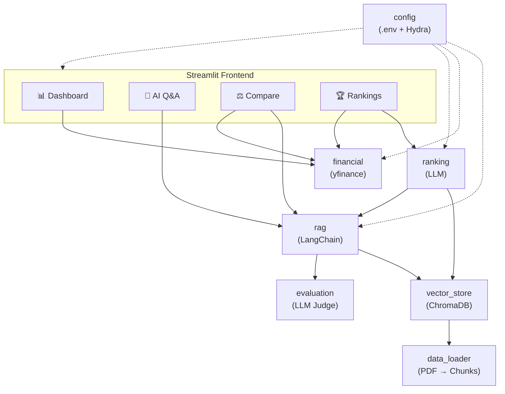

<h1 align="center">DualLens Analytics</h1>

<p align="center">
  <em>RAG-powered investment analysis combining quantitative financial metrics with qualitative AI-initiative insights.</em>
</p>

<p align="center">
  
  
  
  
  
</p>

---

> **⚠️ Disclaimer:** This project is a **demonstration / educational prototype** only. The financial data shown may be outdated or inaccurate. Nothing in this application constitutes financial advice. **Do not** base any investment or financial decision on the analysis produced by this tool.

---

## Overview

DualLens Analytics provides a **dual-lens** view of public companies by merging two complementary perspectives:

1. **Quantitative** — real-time stock prices and key financial metrics sourced from Yahoo Finance.
2. **Qualitative** — AI-strategy insights extracted from company PDF reports through a Retrieval-Augmented Generation (RAG) pipeline.

The result is an interactive Streamlit dashboard that lets users explore, compare, and rank companies for investment potential — all powered by LLMs and grounded in a curated knowledge base.

## Features

| Tab | Description |
|-----|-------------|
| **📊 Dashboard** | Stock price trends, key financial metrics table, bar charts, and radar comparisons |
| **🤖 AI Q&A** | Chat-style RAG interface — ask natural-language questions about company AI initiatives |
| **⚖️ Compare** | Side-by-side financial radar chart and LLM-generated AI-initiative summaries for two companies |
| **🏆 Rankings** | Composite investment ranking that blends financial health with AI-strategy strength |

## Architecture



## Tech Stack

| Layer | Technology |
|-------|-----------|
| LLM | OpenAI `gpt-4o-mini` via LangChain |
| Embeddings | `text-embedding-ada-002` → ChromaDB |
| Financial Data | Yahoo Finance (`yfinance`) |
| Visualisation | Plotly (interactive charts) |
| Frontend | Streamlit (4-tab layout) |
| Configuration | Hydra / OmegaConf + `.env` for secrets |
| Package Manager | Poetry |
| Code Quality | Ruff (lint + format), pytest (36+ tests) |
| Documentation | MkDocs + mkdocs-material + mkdocstrings |

## Quick Start

### Prerequisites

- **Python 3.12+**
- **Poetry** — [install guide](https://python-poetry.org/docs/#installation)

### 1. Clone & install

```bash
git clone <repo-url>
cd project_1_DualLens_Analytics
make install          # or: poetry install --with dev,docs
```

### 2. Configure credentials

```bash
cp .env.example .env
```

Edit `.env` with your API key:

```dotenv
API_KEY=gl-<your-key>
OPENAI_API_BASE=https://aibe.mygreatlearning.com/openai/v1
```

### 3. Launch

```bash
make run              # or: poetry run streamlit run src/duallens_analytics/app.py
```

The app opens at [http://localhost:8510](http://localhost:8510).

> On the **first run** the vector store is built automatically (PDFs are extracted, chunked, and embedded). Subsequent runs load the persisted store from `data/chroma_db/` instantly.

---

### Docker (recommended for deployment)

> Requires **Docker Engine 20+** and the **Compose V2** plugin.

```bash
# 1. Configure credentials
cp .env.example .env       # fill in API_KEY

# 2. Build & start
docker compose up -d       # first build takes ~2 min

# 3. Verify
docker compose ps          # status should be "healthy"
docker compose logs -f app # tail logs

# 4. Stop
docker compose down        # data persists in the duallens-data volume
```

The app is available at [http://localhost:8510](http://localhost:8510).

To **rebuild** after code changes:

```bash
docker compose up -d --build
```

## Development

```bash
make lint             # Ruff lint check
make format           # Auto-format with Ruff
make test             # Run pytest (36+ tests)
make test-cov         # Tests with coverage report
make check            # All of the above in one go
make hydra            # Print resolved Hydra config
make docs             # Build MkDocs site
make docs-serve       # Live-reload doc server at localhost:8000
```

## Project Structure

```
project_1_DualLens_Analytics/
├── .env.example                  # Sample environment variables
├── .github/workflows/docs.yml   # GitHub Pages deployment
├── pyproject.toml                # Poetry config, Ruff, pytest
├── Makefile                      # Dev workflow commands
├── mkdocs.yml                    # Documentation config
├── conf/
│   └── config.yaml               # Hydra structured config
├── docs/                         # MkDocs source pages
├── notebooks/
│   ├── JHU_AgenticAI_Project_1_Solution_Notebook.ipynb
│   └── Companies-AI-Initiatives.zip
├── data/                         # Created at runtime
│   ├── pdfs/                     # Extracted PDF documents
│   └── chroma_db/                # Persisted ChromaDB store
├── tests/                        # pytest test suite
│   ├── test_config.py
│   ├── test_data_loader.py
│   ├── test_evaluation.py
│   ├── test_financial.py
│   └── test_report.py
└── src/duallens_analytics/
    ├── __init__.py               # Package init & logging setup
    ├── config.py                 # Settings, .env + Hydra loader
    ├── data_loader.py            # ZIP extraction & PDF chunking
    ├── vector_store.py           # ChromaDB build / load / retrieve
    ├── financial.py              # Yahoo Finance data & Plotly charts
    ├── rag.py                    # RAG pipeline (retrieve + generate)
    ├── evaluation.py             # LLM-as-Judge (groundedness & relevance)
    ├── ranking.py                # Composite company scoring
    ├── report.py                 # Markdown report generation
    ├── app.py                    # Streamlit entry point
    └── cli.py                    # Hydra CLI entry point
```

## Documentation

Full technical documentation (architecture, API reference, configuration guide) is available via MkDocs:

```bash
make docs-serve       # http://localhost:8000
```

To deploy to GitHub Pages, enable **Settings → Pages → Source: GitHub Actions** in your repository. The included workflow at `.github/workflows/docs.yml` handles the rest on every push to `main`.

## License

This project is released for **educational purposes** as part of the JHU Agentic AI programme.
- **python-dotenv** – environment variable loading
