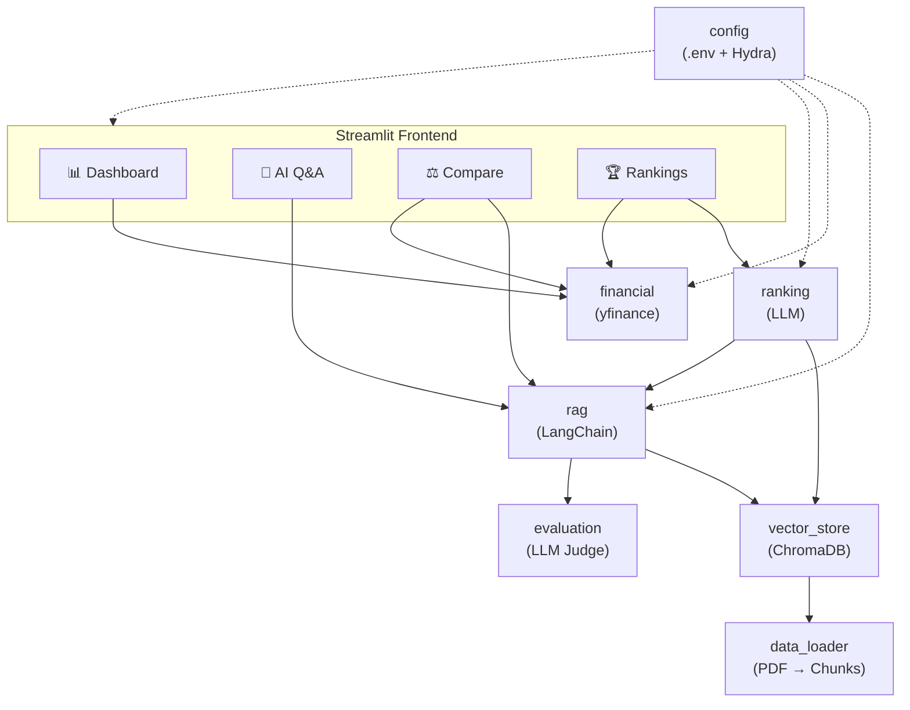

# Architecture Overview

## High-Level Diagram

## Module Responsibilities

| Module | Role |
|--------|------|
| `config` | Load `.env` secrets, merge with Hydra YAML, produce `Settings` dataclass |
| `data_loader` | Extract ZIP archive, load PDFs, chunk via `RecursiveCharacterTextSplitter` |
| `vector_store` | Build/load ChromaDB collection, expose retriever interface |
| `financial` | Fetch stock history & metrics from Yahoo Finance, generate Plotly charts |
| `rag` | Assemble prompt templates, invoke LLM, return answer + source excerpts |
| `evaluation` | LLM-as-Judge prompts for groundedness and relevance scoring |
| `ranking` | Composite ranking prompt combining financial data + AI knowledge |
| `report` | Compile session data into a downloadable Markdown report |
| `app` | Streamlit entry point orchestrating all tabs and sidebar |
| `cli` | Hydra CLI entry point for headless config inspection |

## Data Flow

1. **Ingestion** – PDFs are extracted from a ZIP, split into chunks, and
   embedded into ChromaDB using `text-embedding-ada-002`.
2. **Retrieval** – User questions trigger a similarity search over the
   vector store, returning the top-*k* relevant passages.
3. **Generation** – Retrieved passages are injected into a system prompt
   and sent to `gpt-4o-mini` for answer generation.
4. **Evaluation** – Answers are scored for *groundedness* (faithful to
   sources) and *relevance* (addresses the question).
5. **Financial** – Stock data and key metrics are fetched in parallel from
   Yahoo Finance and rendered as interactive Plotly charts.
6. **Ranking** – Financial metrics and AI-strategy context are fed to the
   LLM for a composite company ranking.
7. **Reporting** – All session artefacts are compiled into a Markdown report.
