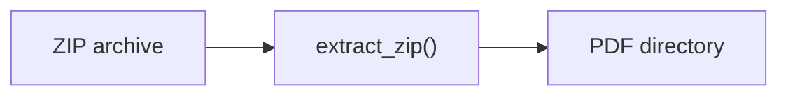

# RAG Pipeline

The Retrieval-Augmented Generation pipeline is the core intelligence layer of
DualLens Analytics. It grounds LLM answers in company-specific PDF documents.

## Pipeline Stages

### 1. Document Ingestion



The `data_loader` module extracts `ai_initiative_reports.zip` into
`data/ai_initiatives/`.

### 2. Chunking

```python
RecursiveCharacterTextSplitter(
    chunk_size=1000,
    chunk_overlap=200,
    length_function=tiktoken (cl100k_base),
)
```

Each PDF is split into overlapping chunks to preserve context across
boundaries.

### 3. Embedding & Indexing

Chunks are embedded with OpenAI `text-embedding-ada-002` and stored in a
**ChromaDB** collection (`ai_initiatives`). The collection is persisted to
`data/chroma_db/` so subsequent runs skip re-indexing.

### 4. Retrieval

```python
retriever = vectorstore.as_retriever(
    search_type="similarity",
    search_kwargs={"k": 5},
)
```

A user question is embedded and compared against stored chunks via cosine
similarity. The top-*k* documents are returned.

### 5. Prompt Assembly

The system prompt instructs the LLM to answer **only** from the provided
context. A user template injects the retrieved passages and the question:

```
CONTEXT:
{context}

QUESTION:
{question}
```

### 6. Generation

The assembled messages are sent to `gpt-4o-mini`. The response and the
source excerpts are returned to the frontend.

## Evaluation Layer

After generation, answers can be evaluated by the **LLM-as-Judge** module:

- **Groundedness** – Is the answer faithful to the retrieved context?
- **Relevance** – Does the answer address the user's question?

Each evaluation returns a score (1-5) and a justification.

## Configuration Knobs

| Parameter | Config Key | Default | Effect |
|-----------|-----------|---------|--------|
| Chunk size | `chunking.chunk_size` | 1000 | Larger = more context per chunk |
| Chunk overlap | `chunking.chunk_overlap` | 200 | Higher = less info loss at boundaries |
| Top-k results | `retriever.k` | 5 | More docs = richer context but noisier |
| Temperature | `llm.temperature` | 0.3 | Lower = more deterministic answers |
| Max tokens | `llm.max_tokens` | 1024 | Cap on answer length |
